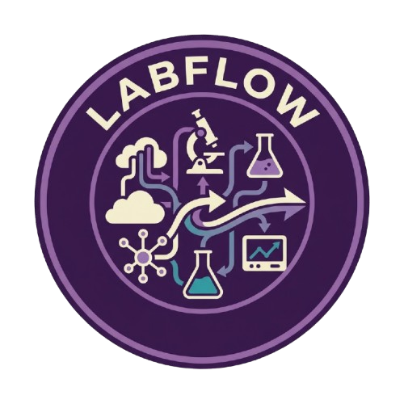
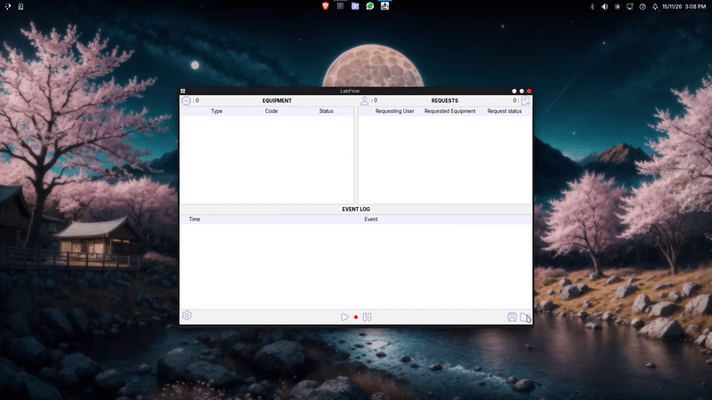

<!-- Header with logo, project name and group name -->
<p align="center">
  <!-- Project Logo -->
  
</p>

<!-- Project Title -->
<h1 align="center">LabFlow</h1>

<!-- Group name -->
<p align="center"">
  <i>A Project by The Beauty And The Beast</i>
</p>

## 🎬 Demo

<p align="center">
  
</p>

You can run this demo by loading the Demo save file found in Docs/Demo

## 🚀 Compile and Run
Download the repository ZIP file and extract it or clone the repositry directly in the CLI by typing:
```
git clone https://github.com/MaroSamaa/LabFlow
```

### CLI
⚠️ Make sure to be in the project's root directory (check by seeing if the 'src', 'bin' and 'lib' folders are directly in the directory you moved to) before doing any of the following.

On Windows:
```
cd LabFlow\LabFlow
```
On Linux/MacOS:
```
cd LabFlow/LabFlow
```

#### WINDOWS (CMD)

Compile the source code:
```
dir /s /b src\*.java > sources.txt && javac -cp "lib/*" -d bin @sources.txt && del sources.txt
```
Run:
```
java -cp "bin;lib/*" Main
```
#### Linux/MacOS
Compile the source code:
```
javac -cp "lib/*" -d bin $(find src -name "*.java")
```
Run:
```
java -cp "bin:lib/*" Main
```
### IDE
Open the project folder then navigate to
Src->Main.java and run the program.

## 📜 Documentation
The project's documentation can be found in the Docs folder

## 💻 Compatibility & System Requirements

* **Tested & Developed with:** JDK 17 (or higher)
* **Minimum Requirement:** Java 11+ (due to UI library FlatLaf)

> 💡 **Backward Compatibility:** While the project has been fully tested on modern JDK versions, it is designed to be compatible with older Java runtimes (JRE 11/17).

LabFlow was verified to run on Windows 11 and Arch Linux (on KDE Plasma), it should run on MacOS but we didn't have any device to test it on.

> ⚠️  High DPI displays may present scaling issues if the OS scales the content (like Windows does) so images and fonts may look a bit blurry.
> For further details see [here](https://github.com/MaroSamaa/LabFlow/issues/19#issuecomment-6864183563).
